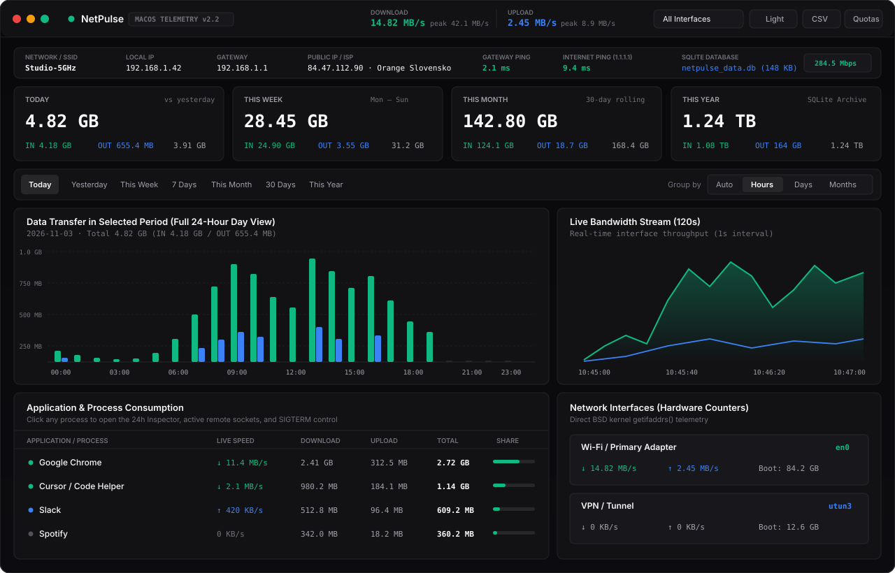
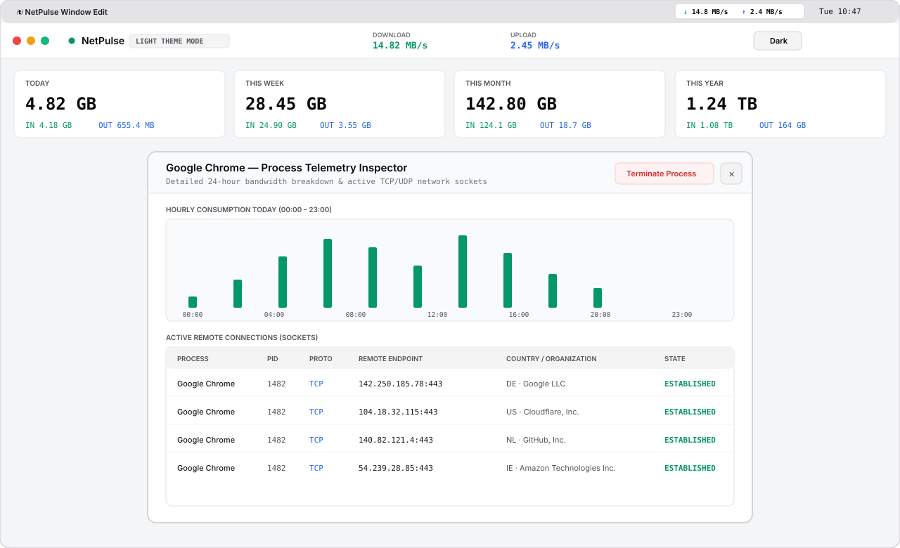

# NetPulse — Native macOS Network Telemetry & Bandwidth Analyzer

<p align="center">
  
</p>

**NetPulse** is a standalone, native macOS network telemetry and bandwidth analysis application written in **Swift** (`Cocoa`, `WebKit`, `SQLite3`, and BSD `getifaddrs()`). It operates with **zero external web servers, zero Python/Node runtimes, and ultra-low battery consumption**, combining a compact real-time macOS Menu Bar monitor with an enterprise-grade analytical dashboard.

---

## Visual Preview — Light Theme, Menu Bar Widget & Process Inspector

<p align="center">
  
</p>

---

## Quick Installation (macOS Universal — Apple Silicon & Intel)

You can install **NetPulse** on any Mac running **macOS 13.0 (Ventura) or newer** in seconds using the included installer package:

### Option A: One-Click Installer Package (Recommended for Colleagues)
1. Download **[`NetPulse-Mac-Installer.zip`](NetPulse-Mac-Installer.zip)** from this repository (or clone the repo).
2. Extract the archive and double-click **`Install_NetPulse.command`** (or **`Instalovat_NetPulse.command`**).
   - *Tip:* If macOS asks for confirmation on first run, right-click **`Install_NetPulse.command`** and select **Open**.
3. The installer automatically:
   - Copies universal **`NetPulse.app`** (`arm64` + `x86_64`) into `/Applications`
   - Clears macOS Gatekeeper quarantine attributes (`xattr -cr`)
   - Launches **NetPulse** in both your Dock and top macOS Menu Bar (`↓ 0 KB/s ↑ 0 KB/s`)

### Option B: Direct Terminal One-Liner
```bash
git clone https://github.com/tpackolus/NetPulse.git
cd NetPulse
./Install_NetPulse.command
```

---

## Key Features

- **100% Standalone Native macOS Application (`NetPulse.app`)**
  - Uses a custom in-memory `WKURLSchemeHandler` (`netpulse://`) bridged directly to native C `SQLite3` and BSD kernel network counters (`getifaddrs()`). No local HTTP ports or background Python/Node servers are ever opened.
- **Compact macOS Menu Bar Live Monitor**
  - Displays live download/upload throughput in compact `9.5pt` monospaced typography (`↓ 14.8 MB/s  ↑ 2.4 MB/s`), plus a quick dropdown showing Today / This Week / This Month totals, Gateway & Internet latency, and Top 3 active processes.
- **Full 24-Hour (`00:00` – `23:00`), Daily, Weekly, Monthly & Yearly Analytics**
  - Complete 24-hour bar chart for any single day (`00:00` to `23:00`), daily breakdown for weeks/months, and 12-month breakdown for yearly views, alongside a 120-second real-time stream.
- **Per-Application Bandwidth Breakdown & Process Inspector**
  - Tracks exact download and upload volume per macOS application/process (`nettop`).
  - Click any application row to inspect its 24-hour usage profile, view active remote TCP/UDP sockets (`lsof`) with IP geolocation/organization lookup, or terminate (`SIGTERM`) a process with one click.
- **Dark Mode & Light Mode + Adaptive Monitor Scaling**
  - Instant switch between **Dark** and **Light** themes (synchronizing both the dashboard and native `NSWindow` appearance).
  - Fluidly scales across 13" MacBook screens, 16" Retina displays, and 4K/5K external monitors (`ResizeObserver` + `NSApplication.didChangeScreenParametersNotification`).
- **Network Diagnostics & Built-in Speedtest**
  - Displays Wi-Fi SSID / network profile, local IPv4, default gateway IP, public IP & ISP, gateway ping, internet ping (`1.1.1.1`), VPN tunnel status (`utun`), and an integrated Cloudflare HTTPS throughput speedtest.
- **Native CSV & JSON Export + Data Quotas**
  - Configure daily, weekly, or monthly bandwidth quotas with alert thresholds, and export any historical date range to CSV or JSON via native `NSSavePanel`.

---

## Battery & CPU Efficiency (Adaptive Eco-Polling)

NetPulse is engineered for minimal energy impact on MacBooks:
- **Direct Kernel Interface Counters (`getifaddrs`)**: Reads hardware interface counters directly from BSD kernel memory in `< 0.05 ms` per second.
- **Adaptive Process Sampling**:
  - **Window Open**: Samples per-process throughput every **3 seconds** (`nettop -n -P -L 1` with DNS resolution disabled for instant execution).
  - **Window Closed to Menu Bar (`Cmd + W`)**: Automatically throttles process sampling to once every **15 seconds**, keeping average CPU usage around **0.1% – 0.3%**.

---

## Where Is Telemetry Data Stored?

All historical traffic metrics and user settings are stored locally in a native **SQLite WAL** database:

```text
~/Library/Application Support/NetPulse/netpulse_data.db
```

- You can open its exact location in Finder at any time by clicking the database path in the top Diagnostics Bar or selecting **Reveal SQLite Database in Finder** (`Cmd + F`) from the Menu Bar icon.
- Data persists across application restarts and macOS reboots.

---

## Building Universal Binary (`arm64` + `x86_64`) from Source

Requires macOS 13.0+ and Xcode Command Line Tools (`swiftc`, `lipo`, `codesign`):

```bash
# 1. Compile for Apple Silicon (arm64)
swiftc -O -target arm64-apple-macos13.0 \
  CoreStorage.swift TelemetryEngine.swift main.swift \
  -framework Cocoa -framework WebKit -lsqlite3 \
  -o /tmp/NetPulse_arm64

# 2. Compile for Intel Macs (x86_64)
swiftc -O -target x86_64-apple-macos13.0 \
  CoreStorage.swift TelemetryEngine.swift main.swift \
  -framework Cocoa -framework WebKit -lsqlite3 \
  -o /tmp/NetPulse_x86_64

# 3. Create Universal Binary inside NetPulse.app bundle
lipo -create -output NetPulse.app/Contents/MacOS/NetPulse \
  /tmp/NetPulse_arm64 /tmp/NetPulse_x86_64

# 4. Sync static UI bundle resources & ad-hoc sign
cp -R static/* NetPulse.app/Contents/Resources/static/
codesign --force --deep --sign - NetPulse.app
```

---

## Repository Structure

```text
NetPulse/
├── CoreStorage.swift            # Native C SQLite3 storage engine & 24h/daily/monthly aggregation
├── TelemetryEngine.swift        # BSD getifaddrs(), adaptive nettop collector, ping & speedtest
├── main.swift                   # Native NSApplication, Menu Bar widget & netpulse:// scheme handler
├── static/
│   ├── index.html               # Analytical telemetry dashboard markup (English)
│   ├── styles.css               # Dark & Light theme design system + responsive monitor scaling
│   └── app.js                   # High-DPI Canvas charts, Process Inspector & native bridge
├── docs/
│   ├── netpulse-dark-preview.svg   # Vector screenshot — Dark Mode dashboard
│   └── netpulse-light-preview.svg  # Vector screenshot — Light Mode & Process Inspector
├── NetPulse.app/                # Standalone Universal macOS Application Bundle
├── Install_NetPulse.command     # One-click English macOS installer script
├── Instalovat_NetPulse.command  # One-click Slovak macOS installer script
└── NetPulse-Mac-Installer.zip   # Ready-to-share Universal macOS installer archive
```
