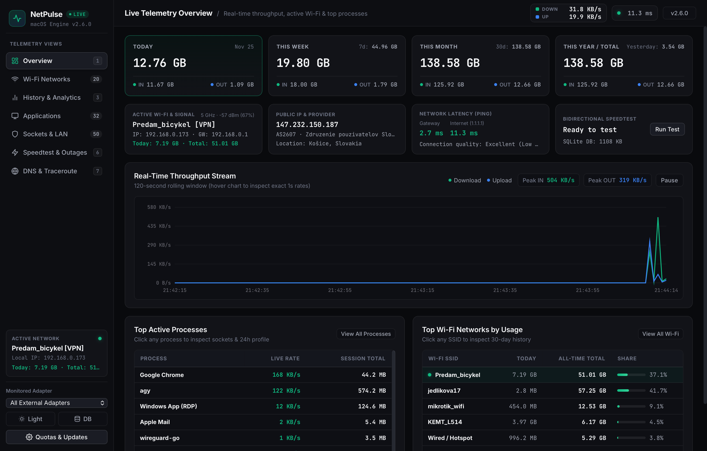
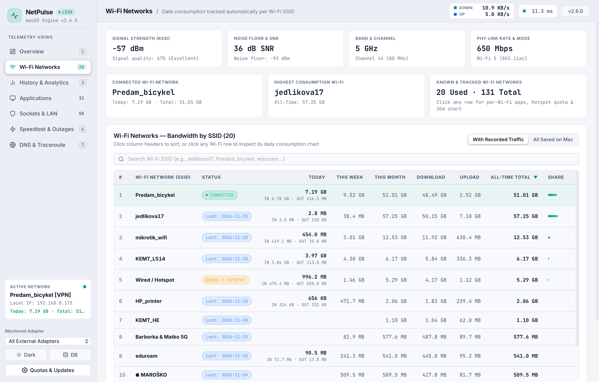
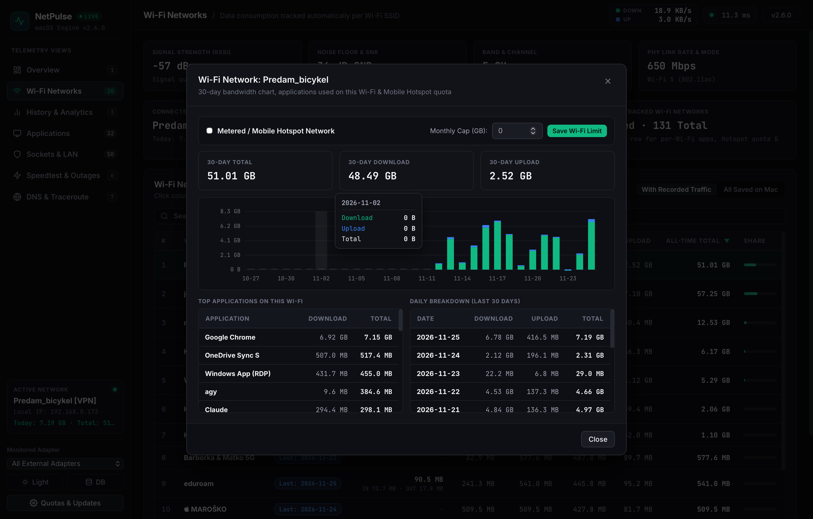

# NetPulse — Native macOS Network Telemetry & Bandwidth Analyzer

<p align="center">
  
</p>

**NetPulse (v2.6.0)** is a standalone, native macOS network telemetry, Wi-Fi radio analyzer, and bandwidth studio written in **Swift** (`Cocoa`, `WebKit`, `CoreWLAN`, `SQLite3`, and BSD `getifaddrs()`). It operates with **zero external web servers, zero Python/Node runtimes, and ultra-low battery consumption**, combining a fixed-width 2-line macOS Menu Bar live monitor + graphical Popover widget with a 7-view native analytical studio.

---

## Light Mode & Process / Wi-Fi Inspector

<p align="center">
  
</p>

<p align="center">
  
</p>

---

## Quick Installation (macOS Universal — Apple Silicon & Intel)

You can install **NetPulse** on any Mac running **macOS 13.0 (Ventura) or newer** in seconds:

### Option A: One-Click Installer Package
1. Download **[`NetPulse-Mac-Installer.zip`](NetPulse-Mac-Installer.zip)** or **[`NetPulse-Mac-Installer.dmg`](NetPulse-Mac-Installer.dmg)** from this repository.
2. Drag **`NetPulse.app`** into `/Applications` (or run **`Install_NetPulse.command`**).
3. Launch **NetPulse** — it appears in both your Dock and top macOS Menu Bar.

### Option B: Direct Terminal One-Liner
```bash
git clone https://github.com/tpackolus/NetPulse.git
cd NetPulse
./Install_NetPulse.command
```

---

## Key Features in v2.6.0

- **7-View Native macOS Sidebar Studio (`1` – `7` Keyboard Shortcuts)**
  1. **Overview (`1`)**: Live KPI cards (`Today`, `This Week`, `This Month`, `This Year`), active Wi-Fi & signal summary, 1-click copyable Public IP, 120-second interactive dual-curve throughput stream with hover crosshairs, and side-by-side Top Processes & Top Wi-Fi Networks.
  2. **Wi-Fi Networks & Radio Quality (`2`)**: Automatic per-SSID bandwidth tracking across all connected & saved macOS Wi-Fi networks, live `CoreWLAN` radio telemetry (`RSSI dBm`, `SNR dB`, `Noise floor`, `2.4 / 5 / 6 GHz` band, channel width, and PHY link rate in `Mbps`), plus a **30-Day Wi-Fi Inspector** showing per-Wi-Fi application usage and **Mobile Hotspot / Metered Quota** caps.
  3. **History & Analytics (`3`)**: Hourly (`00:00` – `23:00`), daily, and monthly stacked bar charts with interactive hover tooltips, custom date intervals, top applications per period, and native CSV / JSON export.
  4. **Applications & Processes (`4`)**: Sortable live & historical process bandwidth matrix with 24-hour per-app charts, active socket inspection, and 1-click `SIGTERM` termination.
  5. **Sockets, GeoIP & LAN Scanner (`5`)**: Live TCP/UDP socket audit with Team Cymru BGP ASN/ISP resolution, ISO country codes, port security heuristics, hardware/VPN interface counters, and a **1-Click Local Subnet LAN Scanner** (ARP + MAC OUI vendor + ping latency).
  6. **Speedtest & Connection Outages (`6`)**: Built-in **Bidirectional Multi-CDN Speedtest** measuring **Download**, **Upload**, **Ping**, and **Jitter** (saved per Wi-Fi SSID in SQLite), paired with an automatic **Internet Outage Log** and native macOS notifications.
  7. **DNS Benchmark & Visual Traceroute (`7`)**: Multi-provider DNS lookup speed benchmark (`Cloudflare`, `Google`, `Quad9`, `OpenDNS`, and local gateway DNS) + interactive hop-by-hop **Visual Traceroute** with Reverse DNS (`PTR`), GeoIP, and BGP ASN lookup, plus **1-Click SQLite Database Backup & Merge Restore**.
- **Zero-Jitter Stacked macOS Menu Bar Monitor + Graphical Popover**
  - Fixed-width (`72pt`) 2-line stacked `↓` / `↑` Menu Bar indicator that never shifts neighboring Menu Bar icons.
  - Left-clicking opens a graphical Mini-Dashboard `NSPopover` with a live 60-second sparkline, Wi-Fi signal strength, ping, daily/weekly/monthly counters, and top active processes (`0% CPU` when closed).
- **1-Click GitHub OTA Self-Updater**
  - Checks `version.json` on GitHub and updates `NetPulse.app` in place with a single click while preserving your entire SQLite telemetry history.

---

## Where Is Telemetry Data Stored?

All historical traffic metrics, Wi-Fi profiles, speedtests, outage logs, and user settings are stored locally in a native **SQLite WAL** database:

```text
~/Library/Application Support/NetPulse/netpulse_data.db
```

---

## Building Universal Binary (`arm64` + `x86_64`) from Source

Requires macOS 13.0+ and Xcode Command Line Tools (`swiftc`, `lipo`, `codesign`):

```bash
# 1. Compile for Apple Silicon (arm64)
swiftc -O -target arm64-apple-macos13.0 \
  CoreStorage.swift TelemetryEngine.swift main.swift \
  -framework Cocoa -framework WebKit -framework CoreWLAN -lsqlite3 \
  -o /tmp/NetPulse_arm64

# 2. Compile for Intel Macs (x86_64)
swiftc -O -target x86_64-apple-macos13.0 \
  CoreStorage.swift TelemetryEngine.swift main.swift \
  -framework Cocoa -framework WebKit -framework CoreWLAN -lsqlite3 \
  -o /tmp/NetPulse_x86_64

# 3. Create Universal Binary inside NetPulse.app bundle
lipo -create -output NetPulse.app/Contents/MacOS/NetPulse \
  /tmp/NetPulse_arm64 /tmp/NetPulse_x86_64

# 4. Sync static UI bundle resources & ad-hoc sign
cp -R static/* NetPulse.app/Contents/Resources/static/
codesign --force --deep --sign - NetPulse.app
```

---

## License

MIT License. Built natively for macOS network diagnostics and bandwidth telemetry.
